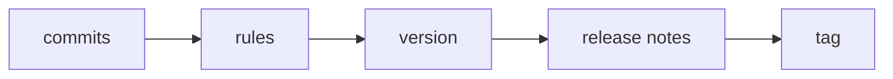

# semver-tag-action

Manual version bumps drift, changelogs get skipped, and tags stop matching what shipped.
This action reads your conventional commits, works out the next version, tags the
commit you pushed and publishes release notes. You never pick a number by hand.



The tag points at a commit already on the branch. The action makes no commit of its own.
The changelog goes into the GitHub release notes, not into the repo.

## Usage

The action needs `contents: write` to push the tag and create the release.

```yaml
name: release
on:
  push:
    branches: [main]

permissions:
  contents: write

jobs:
  release:
    runs-on: ubuntu-latest
    steps:
      - uses: actions/checkout@v7
        with:
          fetch-depth: 0   # the action needs full history and tags
      - uses: zeinhaidara/07-semver-tag-action@main
```

| Input | Default | Meaning |
| --- | --- | --- |
| `dry-run` | `"false"` | Print the next version and the notes path. No tag, push or release. |
| `create-release` | `"true"` | Create a GitHub release from the notes after tagging. |

## Rules

| Commit | Bump |
| --- | --- |
| `!` after the type, or a `BREAKING CHANGE:` footer | major |
| `feat` | minor |
| `fix`, `perf` | patch |
| anything else | no release |

The start point is the latest stable tag like `v1.2.3`. With no tag, the first release is `v0.1.0`.

## Limits

- No pre-release tags. Tags like `v1.2.3-rc1` are ignored.
- No release notes history in the repo.
- Release notes are only as good as the commit subjects.
- Scopes are ignored, not parsed.
- Commit subjects must follow the conventional format.
- Merge commits are ignored.

## Status

Tested with shellcheck and a throwaway-repo test script only. Not yet run as an action in GitHub Actions.
