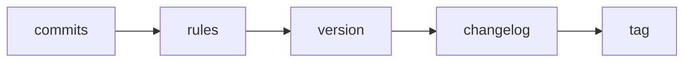

# semver-tag-action

Manual version bumps drift, changelogs get skipped, and tags stop matching what shipped.
This action reads your conventional commits, works out the next version, writes the
changelog entry and creates the tag. You never pick a number by hand.



## Usage

```yaml
name: release
on:
  push:
    branches: [main]

permissions:
  contents: write

jobs:
  release:
    runs-on: ubuntu-latest
    steps:
      - uses: actions/checkout@v7
        with:
          fetch-depth: 0   # the action needs full history and tags
      - uses: zeinhaidara/07-semver-tag-action@main
        with:
          dry-run: "false"
```

Set `dry-run: "true"` to print the next version and change nothing.

## Rules

| Commit | Bump |
| --- | --- |
| `!` after the type, or a `BREAKING CHANGE:` footer | major |
| `feat` | minor |
| `fix`, `perf` | patch |
| anything else | no release |

The start point is the latest tag like `v1.2.3`. With no tag, the first release is `v0.1.0`.

## Limits

- No pre-release tags.
- Scopes are ignored, not parsed.
- Commit subjects must follow the conventional format.
- Merge commits are ignored.

## Status

Tested with shellcheck and a throwaway-repo test script only. Not yet run as an action in GitHub Actions.
